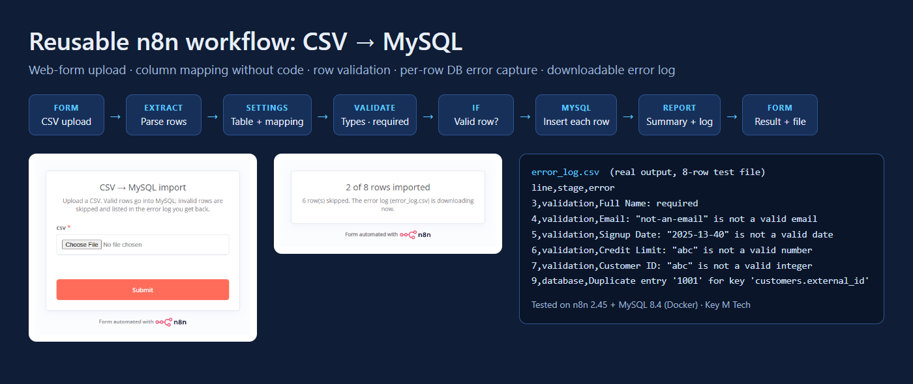

# Reusable n8n workflow: CSV → MySQL

Upload a CSV through a web form. The workflow maps its columns to MySQL fields from one Settings node, validates every row, inserts the valid ones, skips the bad ones, and returns a downloadable `error_log.csv`.

Built by **Key M Tech** as a portfolio demo. Tested end to end on **n8n 2.45 + MySQL 8.4** in Docker.



## What it does

| Requirement | How it's handled |
|---|---|
| Start from a simple web form | An n8n **Form Trigger** at `/form/csv-import` with a single CSV file field |
| Map CSV columns to MySQL fields without code edits | A **Settings** node holds the target table, `columnMap`, required fields, types and max lengths as plain JSON |
| Skip rows with missing or invalid data and keep going | The **Validate & Map** node checks required fields, integer, number (accepts `12,500.50`), date (`YYYY-MM-DD` or `DD/MM/YYYY`, real calendar dates only), email, boolean and max length. Bad rows are marked and routed around the insert |
| Insert all valid rows in one run | The **MySQL** node inserts each row independently, so one row the database rejects (duplicate key, constraint) doesn't stop the others. Rejected rows are caught and logged too |
| Downloadable error log | The final **Form** page shows "X of Y rows imported" and returns `error_log.csv` with `line, stage (validation/database), error` |
| Easy to clone to a new instance | One JSON file to import, plus one MySQL credential. No community nodes and no environment variables |
| Fails clearly on setup mistakes | If the CSV header doesn't contain a mapped column, the run stops with a message naming the missing columns and the ones it found |

Real output from `samples/customers_mixed.csv` (8 rows), saved as [`samples/expected_error_log.csv`](samples/expected_error_log.csv):

```
line,stage,error
3,validation,Full Name: required
4,validation,"Email: ""not-an-email"" is not a valid email"
5,validation,"Signup Date: ""2025-13-40"" is not a valid date"
6,validation,"Credit Limit: ""abc"" is not a valid number"
7,validation,"Customer ID: ""abc"" is not a valid integer"
9,database,Duplicate entry '1001' for key 'customers.external_id'
```

## Use it on your n8n

1. In n8n go to **Workflows → Import from file** and choose `workflow/csv-to-mysql.workflow.json`.
2. Open **Insert into MySQL** and select or create your MySQL credential (host, database, user, password).
3. Open **Settings** and edit the JSON:
   ```json
   {
     "table": "customers",
     "columnMap": { "Customer ID": "external_id", "Full Name": "name", "Email": "email",
                    "Signup Date": "signup_date", "Credit Limit": "credit_limit" },
     "required": ["external_id", "name", "email"],
     "types": { "external_id": "integer", "email": "email", "signup_date": "date", "credit_limit": "number" },
     "maxLength": { "name": 120, "email": 190 },
     "dayFirst": true
   }
   ```
   CSV columns that aren't in `columnMap` are ignored. Set `dayFirst` to `false` for `MM/DD/YYYY` files.
4. **Publish** the workflow and share the form's production URL, or embed it on your site.

To point it at a different table or CSV layout, change `table` and `columnMap` in Settings. Nothing else needs to change.

## Try it locally (Docker)

```bash
bash scripts/local-test.sh
```

The script starts MySQL and n8n, imports the workflow and a local credential, runs both sample CSVs, and prints the table. Then open http://localhost:5678/form/csv-import to try it in the browser.

## Files

```
workflow/csv-to-mysql.workflow.json  the workflow to import
workflow/validate.js, report.js      source of the two Code nodes (readable copies)
workflow/build.py                    regenerates the JSON from the sources above
sql/init.sql                         demo table
samples/                             good CSV, mixed CSV with 6 bad rows, expected error log
docker-compose.yml                   MySQL 8.4 + n8n for local testing
scripts/local-test.sh                one-command end-to-end test
```

## Notes

- Rows are inserted one at a time, so database errors can be tracked per row. That's fine for files of up to tens of thousands of rows. For very large files, switch the MySQL node to batch mode and accept all-or-nothing per batch.
- The passwords in `docker-compose.yml` are throwaway local test values. Use your own credentials in n8n.

## Hire

Key M Tech: RPA, AI agents and workflow automation (n8n-style builders, Automation Anywhere, Python). See the [portfolio](https://trabl3moon.github.io/keymtech-portfolio/) or the [Freelancer profile](https://www.freelancer.com/u/rahulid6).
